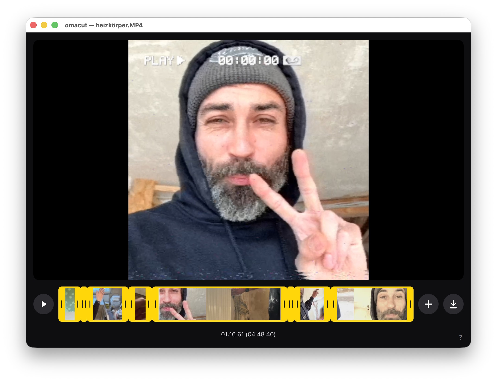

# Omacut

## macOS community fork

This fork adds a native macOS application to [omacom/omacut](https://github.com/omacom/omacut).

**[Download the compiled macOS app](https://github.com/geekhunger/omacut/releases/latest)**

- Apple Silicon (arm64), macOS 26 or later. Intel Macs are not supported by this binary.
- Qt, FFmpeg and FFprobe are included; Homebrew is not required to run the app.
- Native macOS open/save dialogs, export-quality selection and opening videos from Finder.
- Uses macOS video acceleration for preview where supported.
- Community build; not an official upstream release. Updates are manual.

### Install on macOS

Download `Omacut-0.7.3-macos-arm64.zip` from Releases, unzip it and drag `Omacut.app`
to Applications. Alternatively, open the DMG and drag the app to Applications.

This build is ad-hoc signed, **not Apple Developer ID signed or notarized**.
macOS may block its first launch. After trying to open it, use
**System Settings → Privacy & Security → Open Anyway** and confirm the launch.
See [Apple's instructions](https://support.apple.com/en-us/102445).

The release also includes SHA-256 checksums and a separate archive of the
matching third-party sources, patches and build formulas.

### Build and package on macOS

Install Xcode Command Line Tools and the build dependencies:

```sh
brew install qtbase qtdeclarative qtmultimedia qtsvg qtquicktimeline ffmpeg
./bin/build
./bin/test
./bin/package-macos
./bin/collect-macos-sources
codesign --force --deep --sign - dist/Omacut.app
codesign --verify --deep --strict dist/Omacut.app
```

`bin/package-macos` creates `dist/Omacut.app`, bundles dynamic dependencies,
rewrites their load paths, verifies that they resolve inside the app or to
macOS system libraries, and applies an ad-hoc signature.
`bin/collect-macos-sources` downloads and verifies sources matching the installed
dependency versions and adds their license notices; re-sign after this step.
Use the release's pinned source manifest and formulas to reproduce dependency
versions rather than assuming a future `brew install` produces the same build.
`./bin/release-macos` runs the packaging and source steps and creates the ZIP,
DMG, third-party source archive and checksums in `dist/`.

Omacut's own source remains MIT licensed. The downloadable application also
includes GPL/LGPL components; see
[third-party notices](packaging/THIRD-PARTY-NOTICES.txt) and the source archive.

---

A dead-simple video editor. Open a video, trim either end, split it into clips and cut pieces out, add more videos and put the clips in any order, preview the result, and export. On Omarchy, the interface follows your theme's accent color.

Built using **Qt Quick (QML)** UI with the Material style — the same Qt stack Quickshell builds on — and **ffmpeg** for the cut. The C++ side compiles to a single executable; the QML is embedded in it via Qt resources.



## Editing

The timeline shows your clips back to back, in the order they play, each framed with a handle at both ends over its own filmstrip. Whatever isn't in a clip is cut.

- **Double-click a clip** to split it there.
- **Drag a handle** to trim that clip. A trimmed clip can grow back into its video, up to either end.
- **Double-click the line** between two pieces of the same stretch of video to join them again.
- **Hold a clip, then drag it** to move it before or after the others.
- **Hover a clip** and click its **×** to remove it.
- **Click +** to add another video after the clip under the playhead.

Handles catch on neighbouring clip edges and the playhead.

## Hotkeys

These bindings are included in the
[`v0.7.3-macos.1` macOS release](https://github.com/geekhunger/omacut/releases/tag/v0.7.3-macos.1).

`Cmd` means **Command (⌘)**; `Alt` means **Option (⌥)**.

- `Space`: Start/pause video playback.
- `1`–`9`: Jump to 10%–90% of the whole edit.
- `0`: Jump to the start of the edit.
- **Jump to the end:** Unassigned by default. Use its **+** in the shortcut panel to add a binding.
- `Left` / `Right`: Move the playhead by 1 second.
- `Shift+Left` / `Shift+Right`: Move the playhead by 5 seconds.
- `Alt+Left` / `Alt+Right`: Move the playhead by 0.2 seconds.
- `Tab`: Pause and jump to the current clip's out point; repeat to visit the following clips' out points. Preview the selected clip's last frame.
- `Shift+Tab`: Pause and jump to the current clip's in point; repeat to visit the preceding clips' in points. Changing direction first visits the opposite edge of the same clip.
- `S`: Split the clip at the playhead.
- `X`, `Delete` or `Backspace`: Remove the clip under the playhead.
- `-`, `−`, `–` or `—`: Move the current clip one position earlier, keeping the playhead on the same frame of that clip.
- `+`: Move the current clip one position later, keeping the playhead on the same frame of that clip.
- `[`: Move the current clip's start (in marker) to the playhead, then place the playhead at the new clip start.
- `]`: Move the current clip's end (out marker) to the playhead, then place the playhead at the new clip end.
- `Cmd+Z`: Undo.
- `Cmd+Shift+Z` or `Cmd+Y`: Redo.
- `Z`: Zoom into the clip at the playhead; press again to show the whole edit immediately. The view follows the playhead and adapts to edits so the shortest clip spans at least 10% of the visible timeline.
- `F`: Save the frame under the playhead as a PNG next to its video.
- `Cmd+O`: Open a new video; ask first if the current edit has unexported changes.
- `Cmd+Shift+O`: Add a video after the clip under the playhead.
- `Cmd+S`: Export the current edit.
- `Q`: Quit; ask first if the edit has unexported changes.
- `?`: Toggle the shortcut help overlay.
- `X` while the shortcut help is open: Close the help. You can also click its top-right X button; clicking outside the panel leaves it open.
- `Escape`: Dismiss the quit confirmation, open confirmation or shortcut help overlay.

Clip-move shortcuts follow the character typed by the active keyboard layout,
including numeric-keypad `+` / `-` and Option combinations that produce `–` or `—`.
Cmd combinations keep their own meanings. On a German Mac keyboard, type `[`
with `Option+5` and `]` with `Option+6`.

## Customize shortcuts

Open the shortcut panel with `?` or the **?** button. Every configured shortcut is shown, including all alternatives. The listed bindings above are the defaults.

- Click a **yellow shortcut** to replace that one binding. An empty field appears; press the new key or key combination to save it.
- Click the **+** beside an action to record another shortcut. Existing alternatives stay assigned.
- Click the **−** beside a shortcut to remove only that binding. An action with no bindings shows only **+**, so its first shortcut can be added again.
- Changes take effect immediately and remain saved after restarting the app. Recording a key does not run the action.
- To cancel recording, click anywhere outside its input field. The previous binding stays unchanged; a pending new alternative is discarded. Clicking another app cancels recording too.
- If the combination already belongs to another action available in the same context, the panel identifies that action and waits for a different combination.
- **Reset defaults** restores the original bindings.

`Remove clip` starts with **X**, **Delete** and **Backspace**. `Move the clip earlier` starts with **-**, **−**, **–** and **—**. Each alternative can be changed or removed independently.

The help panel has a top-right **X** button and a scrollable list with a pill-shaped scrollbar and track. Its default close shortcut is **X** while the panel is open. Clicking outside the panel leaves it open and cancels any pending shortcut recording.

## Install

Install via the Omarchy Package Repository via the `omacut` package. It's installed by default in new installations of Omarchy (from Quattro forward).

## Requirements

- `xdg-desktop-portal` and a portal backend for the file picker
- `ffmpeg` and `ffprobe` on your PATH (used at runtime)

Exports are always written as MP4 files, regardless of the input video's container. The export dialog offers Original/1080p/720p quality — never upscaling, and always preserving the aspect ratio. When clips come from different videos, the export takes the frame size of the first clip's video; clips of another shape are letterboxed into it, and videos without sound get silence.

## Build

Uses Qt's own build tool, `qmake6` (no cmake needed):

```bash
./bin/build
```

This produces a single `omacut` binary in `build/`.

Requirements:

- A C++17 compiler and Qt6: `qt6-base`, `qt6-declarative` (Qt Quick + Controls),
  `qt6-multimedia`

## Test

```bash
./bin/test
```

## License

MIT. See `LICENSE`.

## Customizations

Compared with [the original Omacut](https://github.com/omacom/omacut) at upstream
commit `612215e2f7f0856ec48fdcaff73bd22d4be7899f`, this fork contains the following
customizations. They are included in the
`v0.7.3-macos.1` source tag and macOS downloads.

### macOS port and release tooling

- **Native macOS application:** Added a Qt `.app` bundle with an application icon, bundle metadata, version information and Finder video-file associations. The published binary targets Apple Silicon and macOS 26 or later.
- **Native file dialogs:** Added macOS open/save panels using AppKit and Uniform Type Identifiers. The save panel exposes Omacut's Original/1080p/720p export choices where applicable; the upstream export-size behavior is preserved.
- **Open from Finder:** Added macOS file-open event handling and routed incoming videos through the existing open/add workflow.
- **Bundled video tools:** Added lookup for `ffmpeg` and `ffprobe` inside the app, followed by PATH and the standard Apple Silicon/Intel Homebrew locations as development fallbacks.
- **macOS video acceleration:** Kept Qt's native macOS decoder selection instead of applying the upstream Linux VA-API/CUDA restriction on macOS.
- **Self-contained downloads:** Added ready-to-run ZIP and DMG releases containing Qt, QML modules, plugins, FFmpeg and their dynamic-library dependencies. The app runs without a separate Homebrew installation.
- **Portable library loading:** Added recursive dependency bundling, rewritten library load paths, explicit Qt plugin/QML paths and checks for missing or machine-local dependencies.
- **Signing and distribution:** Added local ad-hoc signing and strict signature verification, installation/first-launch instructions, build information, test results and SHA-256 checksums. The community build is not Developer ID signed or notarized.
- **Third-party sources and notices:** Added dependency-version/source manifests, checksum-verified source collection, Homebrew build formulas and patches, Qt SPDX metadata and bundled license notices. Omacut's own source retains its MIT license.
- **Build and test support:** Added macOS Objective-C++ sources and Apple frameworks to the qmake projects, taught the test runner to launch its macOS `.app` executable and forward arguments, corrected the build output path, and added packaging/release scripts plus generated-artifact ignore rules.
- **Documentation:** Added a macOS screenshot, the complete Mac shortcut reference and this inventory of changes from upstream.

### Editing customizations

- **Clip-edge navigation:** Replaced `[` / `]` with `Shift+Tab` / `Tab`. Repeated presses traverse clip in/out points; reversing direction visits the other edge of the same clip first. An out-point preview stays on that clip's last frame rather than switching to the next clip.
- **Clip movement:** Replaced `Alt+[` / `Alt+]` with minus/dash characters and `+`. Moving preserves the selected clip, its preview frame and its in/out-edge association, including repeated moves and reversing direction at the sequence boundaries.
- **Clip trimming:** `[` moves the in marker to the playhead and then seeks to the new clip start; `]` moves the out marker and seeks to the new clip end. The edited clip keeps its preview/edge association. Both bindings also work when typed with Option on a German Mac keyboard.
- **Keyboard-layout handling:** Added character-based editing shortcuts for `+`, `-`, `−`, `–`, `—`, `[` and `]`, numeric-keypad keys and macOS Option-generated characters. Physical key codes no longer override the character actually typed; Cmd shortcuts remain separate.
- **Editable shortcuts:** Added recording of single keys/combinations, multiple editable alternatives per action, individual removal, persistent settings, conflict feedback and a defaults reset. Clicking outside the active recording field cancels capture and preserves the previous bindings. The scrollable shortcut panel stays open on outside clicks, has an explicit X close button and uses a pill-shaped scrollbar and background track.
- **Keyboard controls and help:** Removed the modifier-plus-Space trim bindings and switched Mac help/documentation to `Cmd`. Made `0` a dedicated jump-to-start shortcut, retained `1`–`9` for 10%–90% jumps, and updated the in-app help for the revised navigation and movement keys.
- **Zoom toggle:** Changed `Z` so a second press always returns immediately to the whole edit, including after trimming or moving to a different clip.
- **Zoom that follows editing:** Added automatic panning with the playhead during seeking, playback and clip-edge navigation. The zoom adapts when clip lengths change so the shortest clip spans at least 10% of the visible timeline, while preserving stable coordinates during handle/clip drags.
- **Faster clip dragging:** Reduced the hold delay before picking up a clip from 350 ms to 220 ms.
- **Regression coverage:** Added and updated tests for Tab navigation and edge previews, clip movement at in/out points and sequence bounds, typed-character/keypad/dash handling, bracket trimming, help close/scroll behavior, recording, alias management, persistence, conflicts, configurable end jumps, number jumps, zoom following and minimum visible clip size.

### App-update tooling

- Added a staged installer for rebuilt executables: reuse the deployed app's bundled libraries, correct restored Homebrew load paths, re-sign and verify the staged bundle, preserve the previous app in a dated backup, and restore it if installation verification fails. The installer is included as `packaging/install-macos.py`.
